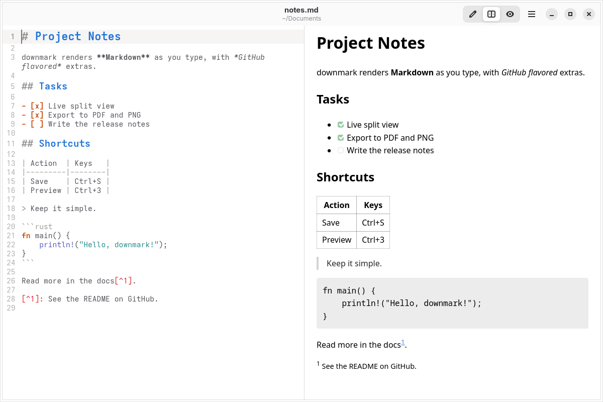

<p align="center">
  
</p>

<h1 align="center">downmark</h1>

<p align="center">
  <em>Write Markdown on the left. See it on the right. That's it.</em>
</p>

<p align="center">
  <a href="https://github.com/GreisMicha/downmark/releases/latest"></a>
  <a href="https://github.com/GreisMicha/downmark/actions/workflows/ci.yml"></a>
  
  
  <a href="https://pay.msero.de"></a>
</p>

<p align="center">
  <picture>
    <source media="(prefers-color-scheme: dark)" srcset="data/screenshot-dark.png">
    
  </picture>
</p>

---

A lightweight Markdown editor with a split view, made for Linux. No accounts, no cloud, no plugins. Open a file, type, save.

- **Just works.** Opens from your app grid or "Open With…". Set it as the default for `.md` files and forget about it.
- **Fast.** Written in Rust. Renders a 1 MB document in ~20 ms, the preview updates while you type.
- **Three views.** Editor, Split, Preview — one click or `Ctrl+1` `Ctrl+2` `Ctrl+3`.
- **Export.** Save the rendered document as PDF (selectable text) or PNG.
- **GitHub flavored.** Tables, task lists, footnotes, strikethrough, fenced code.
- **Yours.** Light, dark or system theme. Every shortcut can be rebound.
- **Safe.** Scripts inside documents never run. Links open in your browser.

## Install

### Arch Linux

```sh
git clone https://github.com/GreisMicha/downmark.git
cd downmark/packaging && makepkg -si
```

AUR package coming soon.

### Other distributions

Build from source. You need [Rust 1.92+](https://rustup.rs) plus GTK 4.12+, libadwaita 1.7+, GtkSourceView 5 and WebKitGTK 6.0.

| Distribution | Dependencies |
|---|---|
| Fedora 42+ | `sudo dnf install gtk4-devel libadwaita-devel gtksourceview5-devel webkitgtk6.0-devel` |
| Debian 13+, Ubuntu 25.04+ | `sudo apt install build-essential libgtk-4-dev libadwaita-1-dev libgtksourceview-5-dev libwebkitgtk-6.0-dev` |

```sh
git clone https://github.com/GreisMicha/downmark.git && cd downmark
make && sudo make install
```

> [!NOTE]
> downmark is developed and tested on Arch Linux. Running it on another distribution? Please [open an issue](https://github.com/GreisMicha/downmark/issues) and tell us whether it works.

## Shortcuts

<details>
<summary>Defaults (change them in <b>Settings → Shortcuts</b>)</summary>

| Action | Keys |
|---|---|
| New window | `Ctrl+N` |
| Open | `Ctrl+O` |
| Save | `Ctrl+S` |
| Save as | `Shift+Ctrl+S` |
| Close window | `Ctrl+W` |
| Editor / Split / Preview | `Ctrl+1` / `Ctrl+2` / `Ctrl+3` |
| Export as PDF | `Ctrl+E` |
| Export as PNG | `Shift+Ctrl+E` |
| Settings | `Ctrl+,` |

</details>

## Make it the default

Right-click a `.md` file → **Open With…** → downmark → **Always use for this file type**. Or:

```sh
xdg-mime default io.github.GreisMicha.downmark.desktop text/markdown
```

## Development

```sh
cargo run -- README.md
cargo test
```

Installing into `~/.local` (`make install PREFIX=~/.local`) is for development only. Remove it with `make uninstall PREFIX=~/.local` before installing a package, otherwise it shadows the system install. Releases: see [PUBLISHING.md](PUBLISHING.md).

## Support

downmark is free and stays free. If it saves you time, you can buy me a coffee:

<p align="center">
  <a href="https://pay.msero.de"></a>
</p>

## License

[MIT](LICENSE)
